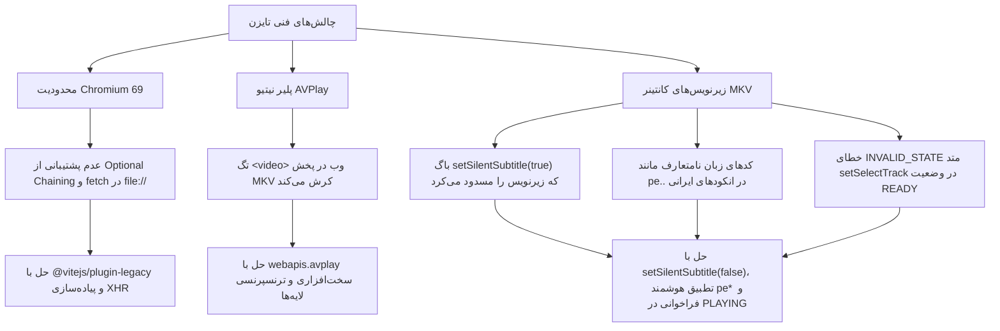

# سی‌کلاد تی‌وی (CCloud TV برای تلویزیون‌های سامسونگ Tizen)

<div align="center">
  
  <br />
  <p><strong>کلاینت اختصاصی، سریع و بدون نیاز به ورود برای تماشای فیلم و سریال‌های سرویس CCloud روی تلویزیون‌های هوشمند سامسونگ (سیستم‌عامل Tizen)</strong></p>
  <p>طراحی‌شده ویژه ریموت کنترل تلویزیون (10-foot UI)، دارای پلیر شتاب‌یافته سخت‌افزاری تایزن (AVPlay) و رندرینگ هوشمند زیرنویس‌های فارسی</p>
</div>

---

## 📑 فهرست مطالب
- [معرفی پروژه](#-معرفی-پروژه)
- [ویژگی‌های کلیدی](#-ویژگیهای-کلیدی)
- [پیش‌نیازها](#-پیشنیازها)
- [راهنمای جامع راه‌اندازی و نصب روی تلویزیون سامسونگ](#-راهنمای-جامع-راهاندازی-و-نصب-روی-تلویزیون-سامسونگ)
- [توسعه و اجرای محلی (Local Development)](#-توسعه-و-اجرای-محلی-local-development)
- [کلیدهای ریموت کنترل](#-کلیدهای-ریموت-کنترل)
- [چالش‌های فنی و راه‌حل‌های کشف‌شده](#-چالشهای-فنی-و-راهحلهای-کشفشده)
  - [۱. محدودیت‌های مرورگر Chromium 69 در تایزن ۵.۵](#۱-محدودیتهای-مرورگر-chromium-69-در-تایزن-۵۵)
  - [۲. معماری پخش نیتیو و شتاب‌دهنده سخت‌افزاری AVPlay](#۲-معماری-پخش-نیتیو-و-شتابدهنده-سختافزاری-avplay)
  - [۳. چالش عمیق زیرنویس‌های فارسی (SoftSub درون MKV)](#۳-چالش-عمیق-زیرنویسهای-فارسی-softsub-درون-mkv)
  - [۴. اولویت‌بندی هوشمند کیفیت سورس‌ها (دوبله در برابر زیرنویس)](#۴-اولویتبندی-هوشمند-کیفیت-سورسها-دوبله-در-برابر-زیرنویس)
  - [۵. ناوبری فضایی ریموت کنترل و طراحی آیکون تایل ۴K](#۵-ناوبری-فضایی-ریموت-کنترل-و-طراحی-آیکون-تایل-۴k)
  - [۶. چالش‌های توسعه‌دهنده در تایزن (ریموت‌های بدون عدد و باگ زبان فارسی)](#۶-چالشهای-توسعهدهنده-در-تایزن-ریموتها-و-باگ-زبان-فارسی)
- [ساختار فایل‌های پروژه](#-ساختار-فایلهای-پروژه)
- [لایسنس و قدردانی](#-لایسنس-و-قدردانی)

---

## 🌟 معرفی پروژه

پروژه **CCloud TV** یک برنامه تحت وب بهینه‌سازی‌شده برای سیستم‌عامل تایزن (سامسونگ) است که به کاربران ایرانی امکان می‌دهد بدون نیاز به کامپیوتر یا کابل HDMI، مستقیماً از طریق ریموت کنترل تلویزیون هوشمند خود به آرشیو عظیم فیلم‌ها، سریال‌ها و انیمیشن‌های ارائه‌شده در شبکه **CCloud** دسترسی داشته باشند.

این اپلیکیشن بر پایه‌ی معماری تلویزیونی پروژه `30nama-tv` بازنویسی شده و بدون نیاز به هیچ‌گونه لاگین یا پرداخت حق اشتراک، مستقیماً با سرورهای پایگاه داده CCloud تبادل داده می‌کند.

---

## ✨ ویژگی‌های کلیدی

| بخش | قابلیت‌ها و توضیحات |
|---|---|
| 🔓 **بدون نیاز به حساب کاربری** | باز شدن آنی برنامه بدون نیاز به شماره موبایل، ثبت‌نام یا اسکن کیوآرکد |
| 🎬 **موتور پخش نیتیو سامسونگ** | استفاده از رابط سخت‌افزاری `webapis.avplay` تایزن جهت پخش روان MKV، MP4 و HLS |
| 📝 **مدیریت پیشرفته زیرنویس** | استخراج خودکار تِرَک‌های سافت‌ساب تعبیه‌شده در ویدیو با فونت **وزیرمتن** و کادر شیشه‌ای خوانا |
| 🧭 **ناوبری روان ریموت کنترل** | پشتیبانی از D-Pad ریموت بر پایه کتابخانه Norigin Spatial Navigation |
| 🔍 **جستجوی دوزبانه زنده** | کیبورد تعاملی روی صفحه تلویزیون با پشتیبانی کامل از حروف فارسی و انگلیسی |
| 🗂️ **دسته‌بندی و فیلترهای دقیق** | تفکیک بر اساس ژانر، کشور سازنده، مرتب‌سازی بر اساس امتیاز IMDb، سال انتشار و جدیدترین‌ها |
| ⏱️ **ادامه تماشا و لیست شخصی** | ذخیره خودکار ثانیه توقف ویدیو در حافظه داخلی تلویزیون و بخش نشان‌شده‌ها |
| 🛠️ **پنل عیب‌یابی درلحظه** | نمایش وضعیت شبکه، تِرَک‌های ویدیویی و خطاها روی صفحه با فشردن دکمه قرمز کنترل |

---

## 📋 پیش‌نیازها

1. **تلویزیون سامسونگ:** سیستم‌عامل **Tizen 5.5 یا بالاتر** (مدل‌های ۲۰۲۰ به بعد نظیر سری TU, AU, BU, CU, DU و تمامی تلویزیون‌های QLED و OLED).
2. **اتصال شبکه:** کامپیوتر و تلویزیون باید به یک شبکه وای‌فای یا مودم یکسان متصل باشند.
3. **محیط توسعه Tizen Studio:**
   - نصب ابزارهای خط فرمان Tizen CLI و SDB (مسیر پیش‌فرض ویندوز: `C:\tizen-studio\tools`).
   - نصب افزونه‌های تلویزیون از طریق پکیج منیجر تایزن:
     ```bash
     package-manager-cli.bin install cert-add-on Certificate-Manager TV-SAMSUNG-Public-WebAppDevelopment --accept-license
     ```
4. **محیط توسعه نود:** `Node.js 20+` به همراه `npm`.

---

## 🚀 راهنمای جامع راه‌اندازی و نصب روی تلویزیون سامسونگ

### ۱. فعال‌سازی حالت توسعه‌دهنده (Developer Mode) در تلویزیون
1. دکمه **Home** یا **Smart Hub** را روی کنترل فشار داده و وارد بخش **Apps** شوید.
2. روی صفحه Apps، کلیدهای عددی `1` سپس `2` سپس `3` سپس `4` و `5` را پشت سر هم فشار دهید.
   > [!TIP]
   > **اگر کنترل تلویزیون شما دکمه‌های عددی ندارد (ریموت هوشمند OneRemote):**
   > اپلیکیشن رسمی **SmartThings** سامسونگ را روی گوشی موبایل خود نصب کرده و به تلویزیون متصل شوید. سپس در بخش ریموت کنترل مجازی گوشی، پد عددی را باز کرده و اعداد `1 2 3 4 5` را به ترتیب وارد کنید تا پنجره فعال‌سازی باز شود.
3. یک پنجره پاپ‌آپ با عنوان **Developer Mode Configuration** ظاهر می‌شود:
   - گزینه **Developer Mode** را روی **On** بگذارید.
   - در فیلد **Host PC IP**، آدرس آی‌پی کامپیوتر خود را در شبکه خانگی (مثلاً `192.168.1.100`) وارد کنید.
   > [!IMPORTANT]
   > **نکته بسیار مهم در صورت فارسی بودن زبان تلویزیون (حل مشکل وصل نشدن SDB):**
   > اگر زبان منوی تلویزیون شما روی **فارسی** تنظیم شده باشد، سیستم‌عامل تایزن به دلیل چیدمان راست‌به‌چپ (RTL)، بخش‌های آی‌پی را معکوس پردازش می‌کند و در نتیجه ابزار SDB موفق به اتصال به تلویزیون نمی‌شود. اگر با خطای وصل نشدن SDB مواجه شدید، آی‌پی کامپیوتر خود را در فیلد تلویزیون به صورت **برعکس** وارد کنید (به عنوان مثال اگر آی‌پی کامپیوتر شما `192.168.1.100` است، آن را به شکل `100.1.168.192` تایپ کنید) یا موقتاً زبان تلویزیون را انگلیسی کنید.
4. تلویزیون را با نگه داشتن دکمه پاور روی ریموت کنترل ری‌استارت کنید تا حالت توسعه‌دهنده فعال شود.

### ۲. اتصال ابزار SDB به تلویزیون
آی‌پی تلویزیون خود را از تنظیمات شبکه تلویزیون پیدا کنید (مثلاً `192.168.100.15`). سپس در ترمینال دستورات زیر را وارد کنید:
```powershell
sdb connect 192.168.100.15:26101
sdb devices
```
باید خروجی مشابه زیر دریافت کنید:
```text
List of devices attached 
192.168.100.15:26101    device        UA55TU8500UXTW
```

### ۳. ساخت پروفایل و گواهی امنیتی سامسونگ (Samsung Certificate)
تلویزیون‌های سامسونگ بسته‌های نرم‌افزاری غیررسمی را بدون امضا نمی‌پذیرند:
1. نرم‌افزار **Certificate Manager** تایزن را باز کنید.
2. گزینه **Samsung Certificate** را انتخاب کرده و با اکانت سامسونگ وارد شوید.
3. نوع گواهی را **TV** انتخاب کنید.
4. در مرحله DUID، با اتصال به تلویزیون، شناسه منحصربه‌فرد DUID تلویزیون شما به طور خودکار اضافه می‌شود.
5. پروفایل گواهی را با نام `CCLOUD` ذخیره کنید.

### ۴. نصب و اجرای خودکار با یک دستور (One-Click Deploy)
اسکریپت اتوماسیون کامل برای ویندوز در [scripts/tv.ps1](file:///c:/projects/ccloud-tizen/scripts/tv.ps1) و برای مک/لینوکس در [scripts/tv.sh](file:///c:/projects/ccloud-tizen/scripts/tv.sh) آماده شده است:

```powershell
# در ویندوز (PowerShell)
.\scripts\tv.ps1 -TvIp 192.168.100.15 -Profile CCLOUD
```

این اسکریپت مراحل زیر را خودکار انجام می‌دهد:
- بیلد بیلد پروداکشن بهینه‌شده با Vite و پلاگین Legacy.
- بسته‌بندی فایل‌های خروجی در قالب پکیج `ccloud-tv.wgt`.
- امضای پکیج با کلیدهای پروفایل `CCLOUD`.
- انتقال به تلویزیون از طریق SDB و اجرای خودکار برنامه روی صفحه تلویزیون.

---

## 💻 توسعه و اجرای محلی (Local Development)

برای توسعه رابط کاربری و تست صفحات روی کامپیوتر:

```bash
# نصب وابستگی‌ها
npm install

# اجرای سرور توسعه
npm run dev
```
سپس آدرس `http://127.0.0.1:5173` را در مرورگر باز کنید.

> **نکته درباره پروکسی CORS:** در مرورگر دسکتاپ، درخواست‌های مستقیم API به دلیل محدودیت‌های CORS مسدود می‌شوند. در محیط توسعه محلی (`npm run dev`)، درخواست‌ها از طریق پروکسی داخلی Vite (`/ccloud-api`) هدایت می‌شوند. اما در نسخه بیلد نهایی تلویزیون (`.wgt`)، از آنجا که برنامه در بستر فایل‌های محلی اجرا می‌شود، ارتباط مستقیم با سرورهای اصلی برقرار می‌گردد.

---

## 🎮 کلیدهای ریموت کنترل

| کلید ریموت | عملکرد در منوها و صفحات | عملکرد در حین پخش ویدیو |
|---|---|---|
| **جهت‌نماها (Arrows)** | جابجایی فوکوس بین پوسترها و دکمه‌ها | **چپ / راست:** عقب و جلو بردن زمان فیلم<br>**بالا / پایین:** نمایش نوار ابزار پخش (OSD) |
| **Enter / OK** | انتخاب و باز کردن فیلم، فصل یا دکمه | توقف / ادامه پخش (Play/Pause) |
| **بازگشت (Back)** | برگشت به صفحه قبل (در صفحه اصلی: بستن برنامه) | بستن منوی کیفیت/زیرنویس؛ بازگشت به صفحه جزئیات |
| **Play / Pause** | — | توقف یا ازسرگیری پخش |
| **FastForward / Rewind** | — | پرش ۳۰ ثانیه‌ای سریع به جلو یا عقب |
| **Next / Prev Track** | — | رفتن به قسمت بعدی / شروع مجدد قسمت فعلی |
| **دکمه قرمز (Red Key)** | نمایش پنجره دیباگ و وضعیت اتصال | نمایش پنجره عیب‌یابی و تِرَک‌های ویدیو |

---

## 🔬 چالش‌های فنی و راه‌حل‌های کشف‌شده

در طول پیاده‌سازی و استقرار پروژه روی تلویزیون سامسونگ مدل `UA55TU8500UXTW` (تایزن ۵.۵)، با چالش‌های فنی عمیقی روبرو شدیم که حل آن‌ها نقشه راه ارزشمندی برای هر توسعه‌دهنده تایزن است:



---

### ۱. محدودیت‌های مرورگر Chromium 69 در تایزن ۵.۵
تلویزیون‌های تولید سال ۲۰۲۰ سامسونگ (از جمله پردازنده‌های Crystal UHD) از نگارش **Chromium 69** به عنوان وب‌ویو داخلی استفاده می‌کنند. این نسخه قدیمی است و بسیاری از ویژگی‌های مدرن جاوااسکریپت را ندارد:
* **سینتکس‌های مدرن:** عملگرهایی نظیر Optional Chaining (`?.`) و Nullish Coalescing (`??`) خطای `SyntaxError: Unexpected token .` در سطح موتور جاوااسکریپت ایجاد می‌کنند.
  - **راهکار:** در `vite.config.ts` افزونه `@vitejs/plugin-legacy` با تارگت‌های قدیمی تنظیم شد تا تمامی فایل‌های خروجی به سینتکس استاندارد سازگار با کرومیوم ۶۹ تبدیل (Transpile) شوند و شیم `window.globalThis` در `index.html` تزریق گردید.
* **محدودیت پروتکل `file://`:** در تایزن، برنامه از مسیر محلی `file:///` بارگذاری می‌شود. مرورگر کرومیوم متد مدرن `fetch()` را روی پروتکل `file://` مسدود می‌کند.
  - **راهکار:** تمام ارتباطات شبکه با سرورها در [src/api/client.ts](file:///c:/projects/ccloud-tizen/src/api/client.ts) بر پایه `XMLHttpRequest` استاندارد پیاده‌سازی شدند.

---

### ۲. معماری پخش نیتیو و شتاب‌دهنده سخت‌افزاری AVPlay
تگ استاندارد وب `<video>` به دلیل کمبود حافظه وب‌ویو توانایی بازگشایی (Demuxing) و دیکود روان فایل‌های با حجم بالا و کدک‌های سنگین کانتینر MKV را ندارد:
* **استفاده از API سخت‌افزاری:** در [src/player/engine.ts](file:///c:/projects/ccloud-tizen/src/player/engine.ts) از آبجکت نیتیو `<object type="application/avplayer">` و API سامسونگ `webapis.avplay` استفاده شد.
* **ترنسپرنسی لایه‌ها (Layer Transparency):** در معماری تایزن، خروجی کارت تصویر ویدیو روی سطحی سخت‌افزاری **پشت** پنجره وب رندر می‌شود. اگر پس‌زمینه صفحات وب شفاف نباشد، ویدیو دیده نمی‌شود. با افزودن کلاس `body.avplay-active` و قوانین CSS:
  ```css
  body.avplay-active,
  body.avplay-active #root,
  body.avplay-active .screen,
  body.avplay-active .player {
    background: transparent !important;
  }
  ```
  تمامی سطوح روی ویدیو ترنسپرنت شده و تنها کنترل‌ها و زیرنویس با لایه‌بندی (`z-index: 20`) روی ویدیو نمایش می‌یابند.

---

### ۳. چالش عمیق زیرنویس‌های فارسی (SoftSub درون MKV)

سرویس CCloud فایل مستقل زیرنویس (`.srt` یا `.vtt`) از طریق API ارائه نمی‌دهد؛ بلکه زیرنویس‌ها به صورت تِرَک متنی داخلی (`S_TEXT/UTF8`) درون فایل‌های MKV قرار دارند. این بخش پیچیده‌ترین چالش پروژه بود که با اتصال مستقیم دیباگر به پردازنده تلویزیون به صورت تجربی حل شد:

1. **باگ متد `setSilentSubtitle`:**
   - متد `avplay.setSilentSubtitle(true)` به سخت‌افزار تلویزیون دستور می‌دهد که دریافت و پردازش زیرنویس را کاملاً سایلنت کند. در نتیجه حتی ایونت `onsubtitlechange` نیز صفر رویداد ارسال می‌کرد!
   - **راهکار:** متد باید صریحاً روی `setSilentSubtitle(false)` تنظیم شود تا دیکودر استریم زیرنویس را فعال نگه دارد و متن‌ها از طریق `onsubtitlechange` به دست برنامه برسند.

2. **خطای وضعیت (`PLAYER_ERROR_INVALID_STATE`):**
   - فراخوانی `avplay.setSelectTrack('TEXT', index)` در وضعیت `READY` (داخل کال‌بک `prepareAsync`) در فریم‌ور تایزن ۵.۵ منجر به خطای وضعیت نامعتبر می‌شد.
   - **راهکار:** پیاده‌سازی مکانیزم انتخاب مؤجل (Deferred Selection)؛ تِرَک زیرنویس ذخیره شده و دقیقاً پس از تغییر وضعیت به `PLAYING` یا `PAUSED` اعمال می‌شود.

3. **کدهای زبان نامتعارف در انکودهای ایرانی (`"pe  "`):**
   - در تست زنده استخراج متادیتا (`getTotalTrackInfo()`) روی تلویزیون، مشخص شد ریلیزهای فارسی (مانند Film2Media و ZarFilm) زبان زیرنویس را به شکل `"pe  "` (با دو فاصله) در کانتینر ذخیره کرده‌اند!
   - ریجکس‌های متداول نظیر `fa|per|farsi` این متادیتا را رد می‌کردند. با پیاده‌سازی تابع اختصاصی `isPersian`:
     ```typescript
     function isPersian(lang: string, name: string): boolean {
       const l = (lang || '').trim().toLowerCase()
       const n = (name || '').trim().toLowerCase()
       return l.startsWith('fa') || l.startsWith('pe') || /فارسی|farsi|persian/i.test(n)
     }
     ```
     تمامی کدهای زبان فارسی با هرگونه فاصله یا پسوند با دقت ۱۰۰٪ شناسایی شدند.

4. **زمان‌بندی و رندرینگ شیشه‌ای زیرنویس در لایه React:**
   - متن تمیزشده از کاراکترهای اضافی کانتینر (`\r` و برچسب‌های استایل) به کامپوننت React فرستاده شده و با فونت زیبای وزیرمتن نمایش می‌یابد.
   - همچنین با استفاده از مقدار `duration` ارسال‌شده از AVPlay، یک تایمر خودکار انقضا تنظیم شد تا زیرنویس‌ها پس از پایان دیالوگ بدون معطلی محو شوند.

---

### ۴. اولویت‌بندی هوشمند کیفیت سورس‌ها (دوبله در برابر زیرنویس)
بسیاری از عناوین CCloud برای یک رزولوشن خاص (مثلاً 720p) دو سورس ارائه می‌دهند: یک نسخه با دوبله فارسی و یک نسخه با زبان اصلی و زیرنویس.
* الگوریتم `pickInitialIndex` در [engine.ts](file:///c:/projects/ccloud-tizen/src/player/engine.ts) ارتقا یافت تا در صورت روشن بودن زیرنویس در تنظیمات، سورس‌های دارای برچسب `زیرنویس` یا `sub` را بر سورس‌های دوبله اولویت دهد.

---

### ۵. ناوبری فضایی ریموت کنترل و طراحی آیکون تایل ۴K
* **Norigin Spatial Navigation:** تلویزیون فاقد ماوس است. تمام دکمه‌ها و پوسترهای برنامه به صورت شبکه‌ای با ریموت کنترل قابل پیمایش هستند و بازگشت از هر صفحه، فوکوس را در موقعیت قبلی حفظ می‌کند.
* **آیکون مربعی ۵۱۲x512:** لانچر سیستم‌عامل تایزن با آیکون‌های دارای گوشه شفاف یا سایه‌های غیر استاندارد دچار کشیدگی یا پس‌زمینه سیاه ناهماهنگ می‌شود. برای لانچر تایل سامسونگ، یک آیکون Full-Bleed با ابعاد دقیق ۵۱۲×۵۱۲ پیکسل با تم مشکی ابسیدین و ابر طلایی نئونی متناسب با تم برنامه طراحی و جایگزین شد.

---

### ۶. چالش‌های توسعه‌دهنده در تایزن (ریموت‌های بدون عدد و باگ زبان فارسی)
* **کنترل‌های هوشمند فاقد کلید عددی (OneRemote):** تلویزیون‌های مدرن سامسونگ تنها دکمه‌های جهتی، برگشت و خانه دارند. برای فشردن پیاپی اعداد `1 2 3 4 5` و ظاهر شدن کادر توسعه‌دهنده، اتصال موبایل از طریق اپلیکیشن **SmartThings** و استفاده از ریموت کنترل مجازی روی گوشی الزامی است.
* **باگ راست‌به‌چپ (RTL) فیلد Host IP در تایزن:** زمانی که زبان تلویزیون روی **فارسی** قرار دارد، سیستم‌عامل تایزن ورودی فیلد آی‌پی را از راست به چپ پردازش می‌کند؛ بنابراین در صورت وارد کردن آی‌پی به صورت عادی، بخش‌ها معکوس ذخیره شده و ارتباط دیمن `sdb` متصل نمی‌شود. وارد کردن آی‌پی به صورت معکوس (مثلاً `100.1.168.192` به جای `192.168.1.100`) یا تغییر موقت زبان تلویزیون به انگلیسی این باگ عجیب تایزن را برطرف می‌کند.

---

## 📁 ساختار فایل‌های پروژه

```text
ccloud-tizen/
├── public/
│   ├── config.xml             # مانیفست تایزن (مجوزها، امتیاز دسترسی، نام و آیکون)
│   ├── icon.png               # آیکون ۵۱۲×۵۱۲ مربعی لانچر تلویزیون
│   └── fonts/                 # فونت وزیرمتن (Vazirmatn) با وزن‌های مختلف
├── scripts/
│   ├── tv.ps1                 # اسکریپت اتوماسیون بیلد، پکیج و نصب در ویندوز
│   ├── tv.sh                  # اسکریپت اتوماسیون در مک و لینوکس
│   └── release.sh             # اسکریپت تولید پکیج ریلیز نهایی
├── src/
│   ├── api/                   # ماژول ارتباط با سرورهای CCloud و تبدیل مدل‌ها
│   │   ├── client.ts          # ارسال ریکوئست‌های XHR مقاوم در برابر فیلترینگ
│   │   ├── config.ts          # آدرس‌های سرور اصلی و سرورهای کمکی (Failover)
│   │   ├── endpoints.ts       # اندپوینت‌های فیلم، سریال، جستجو و فصل‌ها
│   │   └── types.ts           # مدل‌های داده و توابع پارس متادیتا
│   ├── components/            # کامپوننت‌های رابط کاربری (دکمه، منو، کیبورد مجازی)
│   ├── lib/                   # کتابخانه‌های کمکی
│   │   ├── tv.ts              # تعریف تایپ‌های Webapis تایزن و کلیدهای کنترل
│   │   ├── settings.ts        # ذخیره‌سازی محلی تنظیمات کیفیت و زیرنویس
│   │   └── log.ts             # سیستم ثبت لاگ عیب‌یابی درلحظه
│   ├── player/                # هسته پخش ویدیو و زیرنویس
│   │   ├── engine.ts          # پیاده‌سازی پخش سخت‌افزاری AVPlay و فال‌بک HLS/HTML5
│   │   ├── Player.tsx         # کنترل‌های پلیر، OSD، جدول زمان‌بندی و نمایش زیرنویس
│   │   └── subtitles.ts       # توابع پارس و استخراج Cues زیرنویس
│   └── screens/               # صفحات برنامه (خانه، جزئیات عنوان، جستجو، پروفایل)
├── vite.config.ts             # تنظیمات بیلد و پلاگین Legacy برای کرومیوم ۶۹
└── package.json
```

---

## ⚖️ لایسنس و قدردانی

* این پروژه تحت مجوز **MIT License** منتشر شده است.
* با قدردانی ویژه از پروژه پیشگام [30nama-tv](https://github.com/aliir74/30nama-tv) بابت معماری تایزن و ناوبری تلویزیونی.
* با قدردانی از توسعه‌دهندگان اپلیکیشن [CCloud](https://github.com/code3-dev/CCloud) برای مدل‌های محتوا و سرورهای توزیع رسانه.
